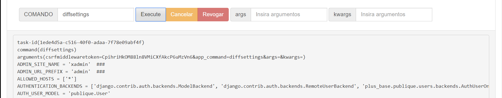
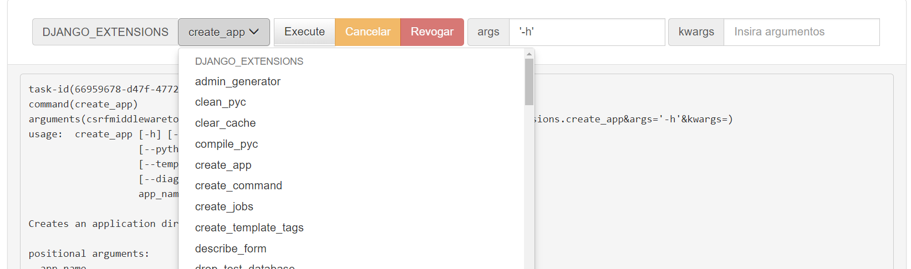

# django-cmd-async

Django app that makes it possible to execute management commands through your web browser.
It uses bootstrap v4 to give the interface a better look.
Commands are run through [Celery](https://docs.celeryq.dev) - Distributed Task Queue, which
allows us to manage execution and return data with ease.

## Requirements

| | |
| --- | --- |
| Python | 3.10 – 3.13 |
| Django | 4.2 – 5.2 |
| Celery | 5.5 – 5.x |

A running Celery worker and broker are required: the page queues a task and then polls for
its output.

## Install

```
pip install django-cmd-async
```

## App configure

#### Add the app to INSTALLED_APPS

```python
INSTALLED_APPS.append("commands_async")
```

#### Include app urls

```python
from django.urls import include, path

urlpatterns.append(path("app/", include("commands_async.urls")))
```

The app prefixes its own routes with `command/async/`, so the example above serves the page
at `/app/command/async/`. Three routes are registered under the `command-async` namespace:

| Name | Path | Login required |
| --- | --- | --- |
| `command-async:index` | `command/async/` | yes |
| `command-async:status` | `command/async/status/<task_id>` | yes |
| `command-async:workers` | `command/async/workers/status/` | yes |

`command-async:status` answers the state, output and traceback of a task, and revokes it
(`POST`). It was open to anyone, and it answered the result of **any** task id, not only of the
tasks launched through the page: since this release it checks the user itself (in the view, not
in the URLconf, so a project that mounts or subclasses the view keeps the check):

- the user has to be authenticated, and, when `COMMANDS_ASYNC_PERMISSION_NAME` names a
  permission, has to hold it (the same permission the form asks for; with none named, any
  authenticated user is served, like the form);
- a denied request gets a response without any task data, marked `no-store`: an XHR (a request
  that sends `X-Requested-With: XMLHttpRequest`, as the bundled JS does) gets a `403` with
  `{"task": null}`; any other request is redirected to `COMMANDS_ASYNC_LOGIN_URL` (not logged in)
  or gets the plain `403` (no permission).

A script that polls this route without a session, or that only asks for JSON (without the
`X-Requested-With` header), now has to authenticate.

### The owner of the task

The route also ties a task to the user who launched it through the form: only that user can
read or revoke it (from any of his login sessions). Anyone else, an id that was never launched,
a record that expired and a registry that cannot be read are all answered the same `404` with
`{"task": null}` and no task data, with any method and before anything of the task is read (a
`403` would tell whoever probes that the id exists). An id that is not a task id at all (the empty
one, which the route accepts on purpose) gets the same `404` with the owner check on or off and
with any method, and nothing of Celery is asked. The id of the task is still the Celery id.

The owner is recorded in a Django cache when the form launches the task. Because of that:

- **Point `COMMANDS_ASYNC_OWNER_CACHE_ALIAS` at a cache that the processes of the host share,
  that nobody clears, and that is not a `DummyCache`.** The local-memory cache (the Django
  default) is not shared between processes: the owner of a task launched in one process would be
  answered `404` in another. A page cache is not a good choice either: it is a `DummyCache` when
  the host switches its cache off, and it is cleared on every content save. A Django system check
  (`commands_async.W001`) warns when the alias is missing from `CACHES` or is a `DummyCache`.
- A task launched before this release, one older than the record's lifetime (24 hours, as the
  default `result_expires` of Celery), and one whose record could not be written (the error is
  logged with the task id) are no longer readable or revocable by their own user.
- `COMMANDS_ASYNC_TASK_OWNERSHIP = False` switches the owner check off: any authorized user reads
  and revokes any task, as before, but an empty task id is still answered `404` (it used to be a
  `500`, because the result backend refuses an empty id). This release narrows what `status`
  serves, so a project that relied on a user following another's tasks has to switch it off.
- A host that mounts a view of its own on the `status` route, extending `TaskFormStatus`, and keeps
  the owner of the task by itself (the `plus_base` does, per login session) has to switch
  `COMMANDS_ASYNC_TASK_OWNERSHIP` off. The two checks run in series through the same `dispatch`:
  the one of the host first and, if it lets the request through, the `task_denial` of the package.
  The two records can disagree (a task launched before the package was updated, or one whose record
  could not be written), and then the package answers `404` `{"task": null}` to a task the host just
  allowed, before the method runs: a revocation is not sent to Celery and nothing that the `post` of
  the host does for it, such as an audit line, happens. With the package check off only the one of
  the host decides, so the host's check has to be the strict one.

`command-async:workers` lists the names of the Celery workers that answer (`GET`). It was open
to any authenticated user, whatever `COMMANDS_ASYNC_PERMISSION_NAME` said: since this release it
has the same gate as `status`, with the same rules, and every denial is answered before Celery
is asked anything (the probe asks every worker and waits for the answers). The denial of an XHR
is a `403` with `{"status": false, "workers": []}`; any other request is redirected to
`COMMANDS_ASYNC_LOGIN_URL` (not logged in) or gets the plain `403` (no permission). A denied
request gets that answer with any method, where it used to get `405` for a method other than
`GET`; an authorized one still gets the `405`.

### Errors, the broker and the 5-second window

Neither route answers the text of a Celery or broker error any more: the text of a kombu error
carries the address of the broker. The detail goes to the log of the package, and the answer
carries a fixed phrase, still with a `200`:

- `command-async:workers`: `{"status": false, "workers": [], "message": "could not ask the Celery
  workers"}` when the query fails, and `"message": "no Celery worker answered"` (with `status`
  false too) when the broadcast collects nothing, which used to surface as the text of a Python
  `TypeError`.
- `command-async:status`, the revocation (`POST`): `{"status": false, "error": "the revocation
  request could not be sent"}`. `COMMANDS_ASYNC_REVOKE_ERROR_DETAIL = True` puts the text of the
  error back in `error`, for a host that shows it only to who may read it. The workers route does
  not read that setting: it always answers the fixed phrase.

The workers route keeps its answer for 5 seconds, per process: a query that arrives less than 5
seconds after the previous one of the same process (from any user, whatever the result: the list,
nobody answered, or a failure) is answered with the previous result without asking Celery again,
and queries that arrive together make one broadcast. So the list can be up to 5 seconds old, a
failure stays for up to 5 seconds after the broker is back, and `N` processes make up to `N`
queries per window. "One broadcast" holds while the query lasts less than 5 seconds: if it lasts
5 seconds or more (a broker that is alive but slow, which the check below does not limit), those
that waited for it ask again, once, and that new query opens the window for the ones that follow.

Both routes first check, with a short limit, that the broker accepts a connection, so that a
broker that refuses the connection or does not answer is answered with a false `status` within 5
seconds. Without the check the Celery configuration of a project may hold the request for minutes
(a `broker_connection_timeout` of 300 seconds, for instance). When the owner registry lives in the
same Redis as the broker and cannot be read, the revocation is answered the `404` of the owner
check before the broker is touched. A `redis://` broker on one host answers a refused port in 2
seconds, an address with no route in 4, and one that accepts the connection and does not answer in
4.4 (measured).

A Sentinel broker (`sentinel://`) is limited the same way: the check gives the hop to the sentinel a
limit of 1 second and no new attempt of redis-py, which retries each call to a sentinel up to 10
times and, when the host defines `sentinel_kwargs` in the `broker_transport_options` of Celery,
leaves that hop with no limit at all. Measured against the Sentinel of the compose (isolated from
the dev Redis), a sentinel with no route or that does not answer is answered in 4.0 to 4.4 seconds,
and three sentinels in the URL (the `;` form of kombu) in 3.0 to 3.4; without the limits the same
cases took 15 seconds, 59 with a `sentinel_kwargs` in the host and up to 179 with three sentinels
and a `retry_on_error`. What the host puts in `sentinel_kwargs` (user, password and the rest) still
reaches the sentinel, except its `retry`, `retry_on_timeout` and `retry_on_error`, which the check
drops (a new attempt would give 6.1 seconds with three sentinels); the limits of 1 second and the
missing new attempt go over it. A master that the sentinels indicate and that accepts the connection
and does not answer takes 4.4 seconds. With `N` sentinels in the URL the check costs about `N`
seconds, so six or more go over 5 (inferred, not measured; the `plus` project mounts one).

What the check does not limit: a broker that is alive but slow (a sentinel or a master that takes
more than 1 second to answer is taken as unreachable), the resolution of a name that does not answer
(redis-py resolves the name before it sets the limit of the socket) and Redis Cluster, which kombu
has no transport for.

Nor does the check limit the call that comes after it (the broadcast of the workers query, the
revocation and `apply_async`): that call waits as long as the Celery configuration of the host lets
it. With one sentinel of a group that accepts the connection and does not answer, the check skips
that sentinel in about 1 second and passes, and the call that follows went without an answer for 90
seconds in the same measurement; with the first sentinel stopped, only the first workers query is
slow (15.8 seconds). Bounding that call is up to the host (the socket options of its
`broker_transport_options`, and `sentinel_kwargs` with Sentinel; not measured here).

The execution form makes the same check right before it queues the command. It comes after the
refusal of an ignored command or of a user without the permission, which never touch the broker.
Without it the form waits for the broker as long as opening the connection takes: with an address
that does not answer, more than 100 seconds were measured, while Celery gives up on a refused port
in about 1.3 seconds. With the check the form answers the usual `400` (`command <name> failed to
execute`) in about 2 seconds for a refused port and about 4 for an address with no route (the
slowest of 6 rounds took 4.35 seconds), with no task, and the text of the error and the address of
the broker only reach the log of the package. A host that runs Celery in synchronous mode
(`task_always_eager`) skips the check, because the task runs in the process with no broker. A host
that wraps `shared_task` to swallow connection errors (as the `plus` project does) used to see this
failure in its own log; the exception now reaches the log of this package, with the traceback. The
same limits apply (the Sentinel ones included, above), and a test that submits the form without
replacing `commands_async.views.precheck_before_launch` opens one connection to the broker of its
environment.

### The status query and the result backend

When a read of the Celery result backend raises (the backend refuses the connection, does not
answer, or fails in any other way), `command-async:status` answers `503` with `{"task": null}`,
`no-store` like every answer of the route, and the package logs the error with its traceback; the
message of the record leaves out the task id, which is client text when the owner check is off.
Before, the exception reached Django, which answered a `500` page. The text of the error and the
address of the backend never reach the answer. The route stops at the read that failed: the
state of a task is read once per query, whatever the state (the retries the client of the backend
makes below Celery do not count), and no read follows the one that failed. The bundled page stops following the task and releases the form on
any HTTP error, as it did with the `500`, and now tells the user why (see "The command page: when the status
query or the form fails").

The route adds no time limit of its own: how long a read waits for a backend that does not answer
is what the Celery of the host gives it. For Redis that is `redis_socket_timeout`
(`CELERY_REDIS_SOCKET_TIMEOUT` with the usual namespace; the Celery default is 120 seconds),
`redis_socket_connect_timeout` (no default: the connection waits as long as the system lets it)
and `redis_retry_on_timeout` (one more attempt per read). Measured on a `redis://` backend on one
host, with 2 seconds for the connection, 3 seconds for the read and `redis_retry_on_timeout` on
(Celery 5.6.3, redis-py 8.1.0): a refused port fails at once, an address with no route in about 4
seconds (two attempts of 2 seconds) and a Redis that accepts the connection and never answers in
about 6 seconds (two attempts of 3 seconds). A host that leaves the Celery defaults may hold the
thread of the server for much longer on each read, so set those options. With Sentinel the limit
for the connections to the sentinels is `result_backend_transport_options['sentinel_kwargs']`,
which Celery leaves empty (and then redis-py does not hand the socket options to the sentinels):
that case was read in the code, not measured.

When the owner registry lives in the same Redis as the result backend and cannot be read, the
query is answered the `404` of the owner check before the backend is touched, as the revocation is
(see above): the `503` is for a failure of the result backend while the owner registry answers.
A task whose state is `REVOKED` or `RETRY` has an exception as its result, which cannot be
serialized: the route answers it `200`, with the text of the exception as `output` (an empty text when
the exception has none, and `null` for a `RETRY` that stored no exception), `ready` true and `failed`
false for a revoked task, and both false for a task being retried.

### The command page: Cancel, the switch of command and Revoke

The bundled page follows a task from the moment the form is sent, not only from the second status
query. **Cancel** (and, when the page shows the list of commands, the **switch of command**) ends
that follow-up wherever it is: while the form is being sent, with the first status query in flight,
or between two queries. The screen is released when the answer in flight arrives, or at once when a
new query was only scheduled, and no status query goes out after it. The released screen has an
empty output panel and no Copy button: the running text of the last query is not left in it (a status query that
fails releases the screen the same way, see the next section).
**The task keeps running**:
stopping it is Revoke, to be used before Cancel, because the page disables Revoke when it releases
the screen. Before, Cancel and the switch were ignored until the second query: the follow-up went
on to the end, with Cancel disabled and its indicator lit.

**Revoke** stays disabled from the submit until the server answers the form with the task, and then
asks for the revocation of **that** task. It used to be enabled at the submit: a click before the
answer raised a script error on the first run, and on the next runs revoked the task of the previous
run.

A host with a page of its own that uses `cmdhandler.js` gets the same through
`cmdasyncform.ajax()`, which wraps the `beforeSubmit` of the page and calls the new `begin()`
(the follow-up is on, no task is known yet) unless the page refused the submit by returning `false`.
`revoke_task()` with no task accepted in the run sends nothing and fires `revoke-failed`, so a page
that enabled its Revoke button early ends the click like any failed revocation. A host that never
goes through `ajax()` keeps the old behaviour of the interruption: it is ignored until the second
query. The `updating` event is fired for the answer of each status query while the follow-up goes
on, and **not** for the answer of an interrupted follow-up, nor for a status query that fails or comes back with no
task (in all these cases the handler empties the output panel and releases the screen instead). `ajax()` may be called more than once: the handler registers its
own `form-valid` callback once per `init()`, so a task is followed by a single chain of status
queries however many times it is called.

### The command page: when the status query or the form fails

When the status query fails the page stops following the task and releases the form, and it now says why (before, it
released the form with no text, and the user could not tell the failure from a task that had ended). The handler
(`cmdhandler.js`) tells the host the reason in the `update-failed` event: `login` (a `200` that is not JSON),
`forbidden` (`403`), `not-found` (`404`), `network` (no answer at all: the network failed, or the query was cut at
`query_timeout`) and `server` (any other failure: a `400`, `401`, `405`, `429`, a `5xx`, an HTML error page, a `2xx`
with a body that is not JSON, or a response that carries no task: a `204` or a `304`, or a `2xx` whose JSON has no `task`
object, or whose `task` object has no text `id` or no boolean `ready`, which only a layer in front of the server, a proxy
or a CDN, or a host with a route of its own, can answer). A host with a page of its own that
tells the reason by `if`/`else` should handle `server` and `network` too. The bundled page shows the text it publishes in `data-server-error-text` and
`data-network-error-text` of `#task-panel` (in the catalog of the package, pt_BR included); a template that does not
publish a text shows none, and the page still releases the form.

**The output panel is emptied on every one of these failures**, whether the follow-up was interrupted or not (before,
only the interruption emptied it). The panel still holds the running text of the last answer (`Running command...`,
translated when the page is), which the failure belies, and the page shows the Copy button by what the panel holds, so
the button goes away with the text. This covers the reasons listed above, the cut at `query_timeout` included. The
handler empties the panel **before** it fires `update-failed` and then `update-finish`, so a listener of those events
that **reads** the panel sees it empty, and what a listener **writes** there stays: to show the reason in the panel,
write it in a listener of `update-failed`. `empty()` discards everything the panel held, not only the running text:
the output of an earlier run (in a host that does not clear it when the form is sent) and what a `form-valid` or
`updating` listener wrote. A host with a template of its own that has no
space for the notice, or publishes no text, now releases the screen with an empty panel and no text at all after the
failure (a failure of the first query already did). A host with its own copy, or an old copy, of `cmdhandler.js` does
not get the change: collect the static files again.

**A response that carries no task ends the status query as the failure `server`.** jQuery resolves a `204` and a `304`
as a success with no data, and the handler used to read `data.task` on them and raise a `TypeError`, which left the
screen stuck; a `2xx` whose JSON has no `task` object (`{}`, `null`, a list, `{"task": null}`, `{"task": "text"}`,
`{"task": 5}`, `{"task": []}`) fired `updating` and then either raised a `TypeError` too or was read as a task that was
not ready and went on asking for `status/undefined`. A `task` object that is not the one the server sends was read by the
truth of its fields, so it did the same: with no `ready` (or a null one) the page asked again every second with no end,
with no text `id` it asked for `status/undefined`, `status/null`, `status/` or `status/5`, and a `ready` that was a text,
a number, a list or an object (`"false"`, `1`) released the screen while the task was still running. Now the handler
tells such a response from a task (the `task` field must be a JSON object with a **text `id` that is not empty** and a
**boolean `ready`**, which is what the server sends, with or without `failed`, `output`, `traceback` and any other field), and for any other
one it does what it does for a failed query: it stops asking, empties the output panel, tells `update-failed` with the
reason `server` and then `update-finish`, and does not fire `updating`. The bundled page shows the server notice, with
the follow-up active or interrupted (an interrupted follow-up used to be released with no notice when the answer was
JSON with no `task`, or a `task` that was not one). A host with a page of its own that listens to `update-failed` now
receives `server` in these cases, where the screen used to stay stuck with no event. A host with a route of its own for the
status query that answers it with another shape of task (a `ready` that is not a boolean, an `id` that is not a text, or a
terminal answer with no `id`) now gets the same notice: have it answer `{"task": {"id": "<text>", "ready": <true|false>, …}}`.
Two details for such a host: `failure_reason(xhr, textStatus)` is
now also called with the `xhr` of a success (a `2xx` or a `304`; `textStatus` is `success`, `nocontent` or `notmodified`),
so an override that assumes a failure status should not trust `xhr.status`; and `query_failed(xhr, textStatus)`, the
method that ends the query for a failure and for a response with no task, is a new public method of `cmdasyncform`. An
empty `200` (no body) is **not** one of these: with `dataType` json jQuery sends it to the failure handler as a
`parsererror` with status `200`, as it does for any `200` that is not JSON, so it still goes to the login.

**A submit answered with no task ends as the failure `server` too.** The submit of the form is answered with
`{"task": {"id": "<text>", "command": {"name": …}}}` (no `ready`: the submit does not wait for the task). A `204`, a `304`,
a `2xx` whose JSON is not an object (`null`, a list, a text, a number, `true`, `false`) and a `2xx` whose JSON has no
`task` object, or whose `task` object has no text `id` that is not empty, used to raise a `TypeError` in `on_form_valid`
and leave the screen stuck, with Execute disabled and no text (Cancel did not release it either), or, with a `task` that
had no text `id`, ask for `status/undefined`. Now the answer is checked in the `success` of the form (`ajax()`), **in front of
the listeners of `form-valid`**, and one that carries no task is told as the failed submit: the notice with the server
text (also when the follow-up was interrupted by Cancel or by the command switch), `update-failed` with the reason
`server` and then `update-finish`, the screen released with no status query, and **no `form-valid`**. `form-valid` now
only means "the server accepted a task". The page also clears the message and the mark that an earlier refused submit
left next to the fields (`requestErrorClean()`, now called by its `update-failed` listener, because this answer passes
neither through `form-valid` nor through the error handler of the form). For a host with a page of its own that listens to
the events: `update-failed` and `update-finish` can now arrive from the submit, **with no `form-valid` before them and
with `cmdasyncform.task` null** (before, every `update-failed` came after a task was accepted, so a listener that reads
`task.id` there would raise); a `form-valid` listener is no longer notified of an answer with no task (the `TypeError` of
`on_form_valid`, first in the list, used to skip the ones after it). The check lives in `ajax()`, in front of
`on_form_valid`: a host that replaces `on_form_valid` to read another shape of answer is not called for an answer with no
text `id`, and a host that does not call `ajax()` (one that fires `form-valid` by hand) is outside the check. A host with a
route of its own for the submit, the revocation or the workers has to answer the shape of the package: the submit
`{"task": {"id": "<text>", …}}`, the revocation `{"status": true}` or `{"status": false, "error": "<text>"}`, and the
workers `{"status": true, "workers": [<names>]}` or `{"status": false, "workers": [], "message": "<text>"}`.

**A revocation answered with no object is a failed revocation.** A `204`, a `304` and a `null` JSON body used to raise a
`TypeError` in the `success` of the revocation, which left the Revoke button disabled with its progress indicator, with no
notice and no `revoke-failed`. They are now the request that failed, like a body with no true `status`: `revoke-failed` is
fired once, the notice shows the text of the failure, and the button comes back while the follow-up goes on. A `status`
that exists is read as it always was (a true one is accepted, a false one fails), whatever its type.

The notice says that **the last command sent may still be running**, and to check before running it again: the status
query only exists once the task was launched, and the released form offers only Execute. The page does not show the id
of the task after the failure, so look in the task monitor or in the logs of the host. A `5xx` or no answer to the
**submit** of the form shows the same two texts. A submit the server refuses (any `4xx`: the `403` of the CSRF check when
the session has expired, a `429`, a `401`...) shows a third text, a different one because the command **was not run**:
"The server refused the request, and the command was not run. If your session has expired, reload the page; otherwise try
again in a moment, or check that you have permission to run commands." The bundled page publishes it in
`data-refused-text` of `#task-panel` (in the catalog of the package, pt_BR included), next to the two others. A `400` with
the errors of the form still marks each field and shows no text in the alert, and the other failure of the submit that
jQuery sends to the failure handler (a `2xx` other than `200` with a body that is not JSON; a `200` that is not JSON is the
login page, above) releases the form and shows no text. A `304`,
and a `2xx` whose JSON carries no task, are not that failure: jQuery resolves them as a success, and they show the server
text (see the paragraph above).

A `400` that does not carry the errors of the form as JSON (`{"form": {"errors": {field: [messages]}}}`, which is what the
server always answers) used to raise a `TypeError` in the page and leave the form stuck, with Execute disabled until the
page was reloaded. Such a `400` comes from a layer in front of the view: the error page of a proxy or a firewall, or
Django's own `400` page (a host that is not allowed, a body that is too big). jQuery only sets `xhr.responseJSON` when the
body parsed as JSON, and the page now reads the errors as something that can be missing: it releases the form like for any
other failure of the submit, marks no field and shows the refusal text (the user would otherwise be told nothing).
This holds in any template, the ones of a host included; the errors of a field that are not a list of messages (`null`)
no longer raise either.

A `400` that marks no field shows the refusal text whatever the reason: no errors at all, an empty `errors`, or errors
only for fields the page does not have (a host with a template of its own may have no argument fields). The page counts a
field as marked when an input it has gets the error, not by the name of the field.

**A host with a template of its own** (or a page that does not use `commands_async/index.html`) has to publish
`data-refused-text` on `#task-panel` to show the refusal text, as it publishes `data-server-error-text` and
`data-network-error-text`. Without it nothing changes from before: the screen is released, no text is shown and no script
error is raised, but the user is still not told that the submit was refused. Check the attribute before taking this
version.

A status query that gets no answer in `cmdasyncform.query_timeout` (30000 ms; `0` turns the cut off, as in jQuery) is
cut and told as `network`. The workers probe reads the same property when each query goes out (the first one, when the
page loads, uses what the host assigned until then; an assignment later applies from the next query) and, when a query
is cut, asks again 5 seconds later, as for any other failure. The submit of the form and the revocation have **no**
time limit: the submit launches the task, and giving up on it would invite the user to launch it twice. The cut is the
browser's, and the server does not see it: the read of the result backend goes on until the limit of the Celery of the
host (see above), and in the workers route the `workers_lock` stays held during the query, so a live but slow broker
keeps one more thread of the server busy per round.

### The workers probe of the page

With `COMMANDS_ASYNC_WORKERS_STATUS_CHECK = True` the page asks `command-async:workers` when it
opens (`celery.workers.status.js`) and shows the notice with the names of the workers, or with the
message of a false `status`. What the probe does with a failure depends on why it failed:

- **`403`** (the gate of the route denied the XHR: no session, or no permission): the probe stops, no
  new query goes out, and the notice opens with "Access denied: your session may have expired, or you
  do not have permission to see the Celery workers." in the place of what it showed. The template of
  the notice publishes the phrase (`data-forbidden-text` of `toast.html`), so it is in the catalog of
  the package and translated (pt_BR).
- **The login page** (an answer that is not JSON, which the browser reaches when a layer outside the
  route redirects): the probe stops and the page takes the user to the login.
- **A false `status`** (nobody answered, the broker failed), **a network failure, a query with no answer in
  `query_timeout` or a server error**: the probe asks again after 5 seconds, as before.
- **An answer without the form the server sends** (a `204` or a `304`, which jQuery resolves as a success with no data,
  JSON that is not an object or has no `status`, or a true `status` whose `workers` is not a list): it is a query that
  failed. The probe used to raise a `TypeError` and stop asking for good, and a `204` that came after the notice was open
  emptied its text first; now the notice stays as it was (open or closed, with its text and its count) and the probe asks
  again after 5 seconds, like for a network failure. A `status` that exists is read as it always was.

A host with a page of its own calls `workers_check_status({onLogin: <function>})`: that function is
what runs on the login page (the bundled page passes its `goToLogin`), and without it the probe just
stops. A notice without `data-forbidden-text`, or a page without the Bootstrap toast plugin (the
`bootstrap.bundle`), stops on the `403` with no notice and no script error. A host with an older
`cmdhandler.js` (without `failure_reason`) keeps asking again after any failure.

## DJANGO settings

### It should show a list of commands to the user. Otherwise, a text input will be displayed.
[bool] COMMANDS_ASYNC_LIST (default: False)

### Login is a required feature, because we need a url.
The way back to the page travels in Django's `next` parameter (`REDIRECT_FIELD_NAME`); there is
no setting for its name.

[str]  COMMANDS_ASYNC_LOGIN_URL  (default: settings.LOGIN_URL)

### List with commands that should be ignored. [runserver, shell, etc]. An error will be shown to the user when the command is in that list.
Entries match either the bare command name (`shell`) or the app-qualified one
(`django.core.shell`).

[list] COMMANDS_ASYNC_COMMANDS_IGNORE  (default: [])

### The user who will perform tasks must have this permission. It does not need to be configured, but if configured, the user will need to have this permission to execute commands. An error message will be shown to the user if he does not have this permission.
[str]  COMMANDS_ASYNC_PERMISSION_NAME  (default: None)

### Options handed to the Celery task, merged over the defaults `{"expires": 1800, "retries": 0}`.
A `priority` key is accepted here and forwarded to `apply_async` instead of the task
decorator.

[dict] COMMANDS_ASYNC_TASK_OPTIONS  (default: {"expires": 1800, "retries": 0})

### Whether the page should probe the workers and warn when none is up.
The probe asks `command-async:workers`, which needs the same permission as the form: when
`COMMANDS_ASYNC_PERMISSION_NAME` names one, a user without it who opens the page gets a `403`,
and the bundled JS stops asking and tells why (see "The workers probe of the page" above).

[bool] COMMANDS_ASYNC_WORKERS_STATUS_CHECK  (default: False)

### Whether the status route serves a task only to the user who launched it.
See "The owner of the task" above. It does not apply to `command-async:workers`.
A host that replaces the view of the route and keeps the owner by itself switches it off (same section).

[bool] COMMANDS_ASYNC_TASK_OWNERSHIP  (default: True)

### The cache alias (a key of `CACHES`) that keeps the owner of each launched task.
It has to be shared by the processes of the host, not cleared and not a `DummyCache`.

[str]  COMMANDS_ASYNC_OWNER_CACHE_ALIAS  (default: "default")

### For how long the owner of a launched task is kept, in seconds.
The default is the default lifetime of a Celery result; after it the user who launched the task is
answered `404` on it, whether or not the backend still has the result.

[int]  COMMANDS_ASYNC_OWNER_TIMEOUT  (default: 86400)

### Whether the failure of a revocation answers the text of the error.
Off (the default), `error` is a fixed phrase and the text of the error goes to the log. See "Errors,
the broker and the 5-second window" above. It does not apply to `command-async:workers`.

[bool] COMMANDS_ASYNC_REVOKE_ERROR_DETAIL  (default: False)

> These settings are read **once, at import time**. Changing them at runtime (including with
> `override_settings`) has no effect until the process restarts.

## Test (python manage.py runserver 8080)
In browser: http://localhost:8080/app/command/async/

## Running the test suite

The suite runs on Django's native test runner and needs neither a broker nor a real database
-- the sqlite in-memory one exists only for the `auth` tables:

```
pip install -e ".[test]"
python runtests.py                            # whole suite
python runtests.py test_cmdasync.test_views   # a single module
coverage run runtests.py && coverage report   # with coverage
```

`msgfmt` (GNU gettext) is needed for the catalog checks; without it they skip.

`node` is needed for the tests of the page scripts (`test_cmdasync/test_page_script.py` runs the real
scripts under it, with a double of jQuery and of the DOM); without it they **fail**, on purpose: a skip
would turn them green without proving anything. The CI installs it (`actions/setup-node`).

## Visual Result




## Credits

Maintained by [Alessandro Hecht](https://github.com/alessandrohc).
Originally created by [Alex Sandro](https://github.com/alexsilva) — released under the MIT license (see [LICENSE](LICENSE)).
